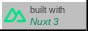
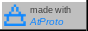
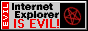
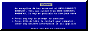
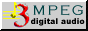
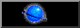
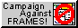
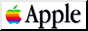
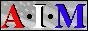

### Kryštof Rainisch

Frontend engineer, 12 years in. Vue/Nuxt and TypeScript daily, with detours into backend, mobile, and infrastructure.

Based in Prague. Currently building in fintech.

Occasionally moving pixels for fun — creative coding, music tools, hardware projects.

<!-- 88x31 wall — oldschool web badges -->

  
  
  
  
  
  
  
  
  
  
  
  
  
  
  
  
  
  
  
  
  
  
  
  
  
  
  
  
  
  

